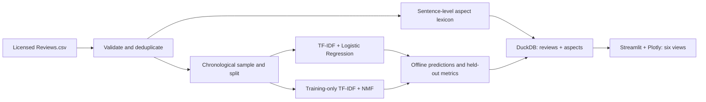

# Customer Voice Intelligence — NLP Insights Dashboard

A reproducible pipeline for analyzing **Amazon Fine Food Reviews** through rating-proxy sentiment classification, NMF topic discovery, sentence-local aspect rules, DuckDB analytics, and a six-page Streamlit dashboard.

**Status:** Source implementation available; the dataset, trained model, measured scores, and dashboard deployment are **not yet generated or validated**. The UI intentionally shows setup instructions when artifacts are absent. There is no live dashboard URL to report.

## Data source and attribution

- Dataset: [Amazon Fine Food Reviews (SNAP on Kaggle)](https://www.kaggle.com/snap/amazon-fine-food-reviews)
- Kaggle listing license: **CC0 (Public Domain)**.
- Original published research: J. McAuley and J. Leskovec, *From amateurs to connoisseurs: modeling the evolution of user expertise through online reviews*, WWW 2013.
- Size: **568,454** rows in the full source; approximately 300.9 MB CSV; script samples up to **12,000** time-spaced reviews after cleaning by default.
- Span: October 1999–October 2012. Language: primarily English, not explicitly language-filtered.
- Relevant source fields: `Id` unique review ID; `ProductId` product identifier; `Score` 1–5 stars; `Time` Unix seconds; `Text` review body. Other published columns include `UserId`, `ProfileName`, `Summary`, and helpfulness counts; these are not retained.
- **Limitations:** Food products are not annotated with product categories; the application filters by product ID, not fabricated categories. 1–2 stars map to negative, 3 to neutral, 4–5 to positive. These labels are **proxies**, not independent human sentiment annotations; reviews may contradict their stars. Older review dates do not reflect current customer behavior.

## Architecture



## Local setup

Python **3.11 or 3.12** recommended.

```bash
git clone https://github.com/NandiniDhanrale/NLP-based-insights-from-unstructured-data.git
cd NLP-based-insights-from-unstructured-data
python -m venv .venv
# On Windows: .venv\\Scripts\\activate
# On macOS / Linux: source .venv/bin/activate
pip install -r requirements.txt
mkdir -p data/raw
# Download Reviews.csv manually from the source link into data/raw/Reviews.csv
python -m src.pipeline --input data/raw/Reviews.csv --limit 12000 --topics 8
pytest -q
streamlit run app.py
```

Outputs: `artifacts/reviews.duckdb`, `artifacts/metrics.json`, and `artifacts/sentiment.joblib`. The `artifacts/` directory is gitignored; local runs do not commit large raw files or serialised models.

## Modeling and interpretation

- **Sentiment baseline:** TF-IDF unigrams/bigrams and class-balanced Logistic Regression. Reviews are sorted chronologically and split 70% training / 15% validation / 15% test. Identical normalized review texts are removed globally before splitting. No tuning on the test set.
- **Evaluation:** Held-out per-class precision/recall/F1, macro F1, confusion matrix. Actual values appear only after a real run in `metrics.json`. No fabricated benchmark or transformer comparison.
- **Topics:** NMF fitted only on training reviews; all reviews assigned the highest-weight topic. Displayed keyword sets are *not* validated semantic labels. Example reviews support manual interpretation.
- **Aspects:** Explicit food-relevant lexicons (taste, price, packaging, delivery, freshness, texture), identified per sentence; polarity terms with a limited three-token negation window. If sentiment is absent, results are `unknown`; conflicting sentence outcomes become `mixed`. This baseline is **not** a validated aspect-based sentiment classifier and can misread sarcasm, mixed feelings, and distant modifiers.
- **Sampling:** Time-spaced systematic sampling supports visualization over the historical span but is not a random, population-representative estimate. Results describe the selected sample only.
- **No model confidences:** Classifier probabilities are not calibrated. Inference is CPU-based from a locally saved joblib artifact; do not load untrusted joblib files.

## Dashboard pages

Executive Overview, Sentiment Analytics, Topic Discovery, Aspect Insights, Model Evaluation, Review Explorer. Global filters for date, product ID, predicted sentiment, topic and aspect operate on the stored dataset. Optional single-review prediction uses the saved baseline.

## Deployment (not yet deployed)

1. Run the training pipeline with the actual licensed CSV and check `metrics.json`, topic samples, and the application locally.
2. For a public Streamlit Community Cloud instance, make the **derived** artifacts accessible to the deployment process. The default `.gitignore` excludes these files. For a small reviewed artifact set, explicitly commit the three generated artifacts (after checking their size and review text redistribution implications), or add a trusted remote artifact download on startup with caching. Do **not** commit the 300 MB raw CSV.
3. Open [Streamlit Community Cloud](https://share.streamlit.io), create an app using this repository, branch `main`, and entry point `app.py`, then verify the actual resulting URL.
4. Add the verified public URL and real dashboard screenshots to this README only after successful deployment.

## Known gaps / next evidence to gather

The full source dataset has not been executed in this environment. No real model metrics, screenshots, trained artifacts, or public URL are asserted. Transformer benchmarking, human-labeled complaint taxonomy, aspect annotation gold data, and topic quality studies would be **separate evaluated extensions**, not claims made by this implementation.
